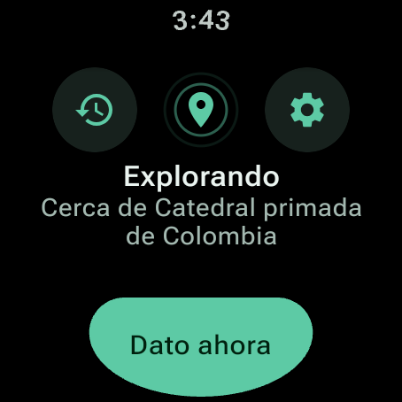
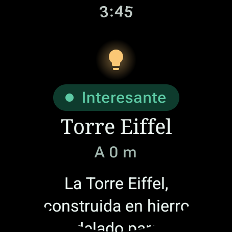
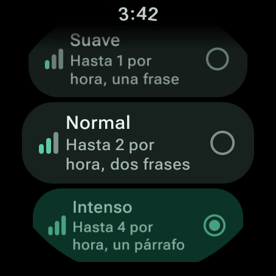
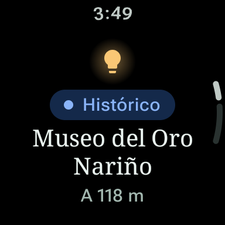

# ExplorIA — Datos con IA sobre los lugares que tienes cerca (Wear OS)

**ExplorIA** es una aplicación *standalone* para relojes inteligentes **Wear OS** que acompaña a la persona mientras camina: detecta cuándo pasa cerca de un lugar emblemático (una plaza, una iglesia, un museo, un teatro, un monumento) y le cuenta un dato breve sobre él, generado con inteligencia artificial a partir de información real.

Funciona **en cualquier lugar del mundo**, no solo en Pasto, y permite elegir el tipo de dato (interesante, histórico, cómico, curioso o gastronómico) y la intensidad con la que aparece.

> **Proyecto de la materia Diseño de Software.** Los dos ejes del trabajo son la arquitectura (Clean Architecture + MVVM + patrones de diseño explícitos, sin código espagueti) y el diseño visual (Compose for Wear OS Material 3 con un design system propio, pensado para pantallas redondas).

| | |
|---|---|
| **Plataforma** | Wear OS (Android 11+, `minSdk 30`) |
| **Lenguaje** | Kotlin 2.4 |
| **Interfaz** | Jetpack Compose for Wear OS, Material 3 |
| **IA** | OpenAI Responses API |
| **Pruebas** | 132 tests unitarios, Android Lint sin errores |
| **Sitio del proyecto** | `https://TU-PROYECTO.vercel.app` *(pendiente: reemplazar al publicar en Vercel; el código está en [`web/`](web/))* |
| **Descargar APK** | [Última versión en GitHub Releases](https://github.com/Daxlejo/ExplorIA/releases/latest) |

## Contenido

1. [Qué hace ExplorIA](#1-qué-hace-exploria)
2. [Capturas](#2-capturas)
3. [Tecnologías utilizadas](#3-tecnologías-utilizadas)
4. [Arquitectura](#4-arquitectura)
5. [Patrones de diseño](#5-patrones-de-diseño-y-dónde-viven)
6. [Cómo se genera un dato](#6-cómo-se-genera-un-dato)
7. [Design system](#7-design-system)
8. [Configuración e instalación](#8-configuración-e-instalación)
9. [Pruebas](#9-pruebas)
10. [Demo: ruta GPX y teletransporte](#10-demo-ruta-gpx-y-teletransporte)
11. [Guion de demostración (5 minutos)](#11-guion-de-demostración-de-5-minutos)
12. [Control de costos de la IA](#12-control-de-costos-de-la-ia)
13. [Estructura del repositorio](#13-estructura-del-repositorio)
14. [Dificultades y decisiones técnicas](#14-dificultades-y-decisiones-técnicas)
15. [Limitaciones conocidas](#15-limitaciones-conocidas)
16. [Fuentes de datos y créditos](#16-fuentes-de-datos-y-créditos)

---

## 1. Qué hace ExplorIA

- **Ubicación en tiempo real.** Usa `FusedLocationProviderClient` solo en primer plano, con el flujo de permisos de Android y estados diseñados para *sin permiso* y *sin GPS*.
- **Solo lugares emblemáticos.** Un lugar califica si tiene artículo en Wikipedia o etiquetas patrimoniales/turísticas en OpenStreetMap, y si está a menos de 150–250 m. Una calle, una casa o una tienda nunca disparan un dato automático.
- **Datos generados con IA, sin inventar.** El modelo recibe únicamente el texto real del lugar como contexto y responde en español, en texto plano.
- **Tipo de dato configurable** (selección múltiple, mínimo uno): *Interesante, Histórico, Cómico, Curioso, Gastronómico*, con un interruptor **Aleatorio**.
- **Tres intensidades** con ventana móvil de 60 minutos:

  | Nivel | Datos automáticos | Largo | Tope de tokens de salida |
  |---|---|---|---|
  | Suave | máx. 1 por hora | 1 frase | 60 |
  | Normal | máx. 2 por hora | 2 frases | 110 |
  | Intenso | máx. 4 por hora | párrafo corto | 220 |

- **Botón "Dato ahora".** Ignora los topes por hora y siempre responde: si no hay ningún hito cerca, cuenta algo del municipio.
- **Historial persistente (Room).** Agrupado por día (*Hoy, Ayer, fecha*), con favoritos, filtro *Solo favoritos* y borrado. También evita repetir lugares mostrados hace poco.
- **Voz y vibración.** Lectura en voz alta con TextToSpeech en español y vibración con patrón propio al llegar un dato.
- **Caché y Modo demo.** Un dato ya generado nunca se vuelve a pedir a OpenAI, y el Modo demo permite recorrer la ruta de Pasto sin internet y sin tope por hora.

---

## 2. Capturas

Capturas tomadas en el emulador oficial de Wear OS (*Large Round*, API 37).

| Inicio (explorando) | Dato real (París) | Acciones del dato | Historial |
|---|---|---|---|
|  |  |  |  |

| Intensidad | Modo demo | Sin internet (Pasto) | Pantalla pequeña (192 dp) |
|---|---|---|---|
|  |  |  |  |

Todas las capturas (permisos, estados de error, fuente grande `1.24x` y pantalla pequeña) están en [`auditorias/capturas/`](auditorias/capturas/).

---

## 3. Tecnologías utilizadas

| Área | Tecnología | Versión |
|---|---|---|
| Lenguaje | Kotlin | 2.4.21 |
| Build | Android Gradle Plugin / Gradle | 9.5.1 / 9.9.1 |
| UI | Jetpack Compose (BOM) | 2026.09.00 |
| UI para reloj | Compose for Wear OS Material 3 | 1.7.1 |
| Asincronía | Kotlin Coroutines / Flow | 1.11.0 |
| Base de datos | Room (historial) | 2.8.5 |
| Preferencias | DataStore Preferences (configuración) | 1.3.0 |
| Ciclo de vida | AndroidX Lifecycle | 2.11.0 |
| Red | OkHttp | 5.5.1 |
| JSON | kotlinx.serialization | 1.13.0 |
| Ubicación | Google Play Services Location (Fused) | 21.4.0 |
| Pruebas | JUnit 4 + coroutines-test | 4.13.2 |

**Servicios externos:** Wikipedia (API GeoSearch y resúmenes), OpenStreetMap Nominatim y OpenAI Responses API. Las versiones viven en [`gradle/libs.versions.toml`](gradle/libs.versions.toml). Configuración mínima: `minSdk 30`, `compileSdk 37`.

---

## 4. Arquitectura

Clean Architecture ligera + MVVM + flujo de datos unidireccional (cada pantalla expone un `StateFlow<UiState>` inmutable). Las dependencias apuntan siempre hacia `domain`, que es Kotlin puro y no importa nada de `android.*`. La inyección de dependencias es manual, en `AppContainer`.

```text
app/src/main/java/com/daxlejo/datoscerca/
├── domain/   Kotlin puro: modelos, errores, puertos (interfaces), motor de datos y casos de uso
├── data/     Implementaciones: GPS, lugares, IA, caché, Room, DataStore, red y demo
├── ui/       Design system, componentes, pantallas y ViewModels
└── di/       AppContainer y FabricaViewModels
```

| Capa | Responsabilidad | Ejemplos |
|---|---|---|
| `domain` | Reglas de negocio, sin Android | `PoliticaIntensidad`, `FiltroRelevancia`, `PromptBuilder`, `ObtenerDatoParaUbicacion` |
| `data` | Habla con el mundo exterior y traduce al dominio | `ProveedorUbicacionFused`, `CadenaFuentesLugares`, `GeneradorDatosOpenAi` |
| `ui` | Muestra estado y envía eventos, sin lógica | `InicioPantalla`, `DatoViewModel`, `TarjetaDato` |
| `di` | Conecta las implementaciones con los puertos | `AppContainer` |

Gracias a esta separación, en la primera fase la app funcionó con datos simulados y en la segunda se reemplazaron por las fuentes reales **sin modificar el dominio**. Los diagramas completos (capas, clases, secuencia y máquina de estados) están en [`docs/arquitectura.md`](docs/arquitectura.md).

---

## 5. Patrones de diseño y dónde viven

| Patrón | Dónde | Para qué |
|---|---|---|
| **Repository** | `RepositorioHistorial` y `RepositorioConfiguracion` (dominio) → `RepositorioHistorialRoom` y `RepositorioConfiguracionDataStore` (data) | Aislar al dominio de Room y DataStore |
| **Chain of Responsibility** | `CadenaFuentesLugares`: Wikipedia es → Wikipedia en → Nominatim → búsqueda web de OpenAI → municipio | Probar fuentes en orden hasta hallar un hito relevante |
| **Strategy** | `PoliticaSuave` / `PoliticaNormal` / `PoliticaIntenso` y `SelectorEnOrden` / `SelectorAleatorio` | Cambiar la regla de intensidad y la elección del tipo de dato |
| **Decorator** | `GeneradorDatosConCache` sobre `GeneradorDatosOpenAi`; `PoliticaDemo` sobre la política activa | Agregar caché y modo demo sin tocar las clases base |
| **Builder** | `PromptBuilder` | Armar la instrucción para la IA con el contexto recortado a 1200 caracteres |
| **Observer** | `Flow`, `StateFlow` y `SharedFlow` en ubicación, configuración, historial y ViewModels | La UI reacciona sola a los cambios |
| **State** | `EstadoMotor`, `EstadoUbicacion` y los `UiState` sellados de cada pantalla | Evitar combinaciones de estado inválidas |
| **Factory** | `FabricaPoliticas`, `FabricaSelectores`, `FabricaViewModels` | Crear estrategias y ViewModels |
| **Adapter** | `ProveedorUbicacionFused`, `ClienteHttpOkHttp`, `RelojSistema`, `VibradorAndroid`, `NarradorTts`, `EntradaMapper` | Traducir APIs de Android, OkHttp y Room al dominio |

---

## 6. Cómo se genera un dato

1. `ProveedorUbicacionFused` emite la coordenada actual como `Flow`.
2. `MotorAutomatico` observa la ubicación, respeta la pausa y la política de intensidad y pide lugares cercanos.
3. `CadenaFuentesLugares` consulta las fuentes en orden y devuelve candidatos con su contexto (el resumen del artículo).
4. `FiltroRelevancia` descarta lo que no es emblemático o está lejos; `FiltroRepeticion` descarta lo mostrado hace poco.
5. `SelectorTipoDato` elige el tipo (fijo o aleatorio) y `PromptBuilder` arma el prompt.
6. `GeneradorDatosConCache` busca en la caché por `lugar + tipo + intensidad`; solo si no existe llama a `GeneradorDatosOpenAi`.
7. El dato se guarda en el historial (Room), el reloj vibra y la pantalla **Dato** se abre.

Los errores (sin internet, tiempo agotado, fallo de la IA, sin lugares) se modelan con clases selladas (`ErrorDato`, `Resultado`) y cada uno tiene su pantalla diseñada; nunca se usa `!!` ni `catch` vacíos.

---

## 7. Design system

Definido en `ui/theme` y reutilizado por todos los componentes:

- **Paleta OLED:** fondo negro, primario teal `#1D9E75` / `#5DCAA5`, acento ámbar `#FAC775` (bombillo de descubrimiento y favoritos) y un color por tipo de dato con contraste WCAG AA.
- **Tipografía:** el nombre del lugar en *serif* (como la placa de un monumento) y el cuerpo en *sans-serif*, centrado con margen lateral seguro para el borde curvo.
- **Tokens:** espaciado, formas, duraciones y animaciones centralizados en `Tokens.kt`; área táctil mínima de 48 dp.
- **Pantallas redondas:** `AppScaffold`, `ScreenScaffold`, `TransformingLazyColumn`, `EdgeButton` y `TimeText`.
- **Componentes:** `ChipTipoDato`, `IndicadorIntensidad`, `TarjetaDato`, `FilaHistorial`, `BotonFavorito`, `PantallaEstado`, `PulsoExplorador`, `BombilloEncendido`.
- **Verificado en:** reloj redondo grande, reloj pequeño (192 dp) y fuente grande (`1.24x`). Cada pantalla tiene `@Preview` para esos tres casos.
- **Ícono:** adaptive icon con un pin de ubicación y un bombillo.

---

## 8. Configuración e instalación

**Requisitos:** Android Studio reciente, JDK 17+, el emulador *Wear OS Large Round* (API 37) y, para datos reales, una API key de OpenAI.

1. Clona el repositorio y copia [`local.properties.example`](local.properties.example) como `local.properties` (Git lo ignora):

   ```properties
   sdk.dir=C\:\\Users\\TU_USUARIO\\AppData\\Local\\Android\\Sdk
   OPENAI_API_KEY=tu_clave
   OPENAI_MODEL=gpt-6-luna
   OPENAI_WEB_SEARCH=false
   ```

   `BuildConfig` inyecta estas propiedades al compilar. **Nunca pongas claves en el código ni las subas a Git.** `OPENAI_WEB_SEARCH` se deja en `false` para ahorrar presupuesto.

2. Compila, prueba y revisa lint:

   ```bash
   ./gradlew assembleDebug testDebugUnitTest lint
   ```

3. Con el emulador abierto (`adb devices` debe mostrar `emulator-5554`), instala y abre la app:

   ```bash
   adb -s emulator-5554 install -r app/build/outputs/apk/debug/app-debug.apk
   adb -s emulator-5554 shell am start -n com.daxlejo.datoscerca/.ui.MainActivity
   ```

4. Concede el permiso de ubicación (*While using app*). La pantalla pasa a **Explorando**.

---

## 9. Pruebas

`./gradlew testDebugUnitTest` ejecuta **132 pruebas unitarias** (0 fallidas); `./gradlew lint` termina sin issues.

| Qué se prueba | Clases de prueba | Tests |
|---|---|---|
| Casos de uso (`ObtenerDatoParaUbicacion`, `ObtenerDatoAhora`, configuración, historial y generación en curso) | `ObtenerDatoParaUbicacionTest`, `ObtenerDatoAhoraTest`, `CasosDeConfiguracionTest`, `CasosDeHistorialTest`, `ConfiguracionTest`, `GeneracionEnCursoTest`, `GeneracionUnicaTest` | 50 |
| Motor automático y llegada a lugares | `MotorAutomaticoTest` | 12 |
| Selección de tipo y filtros de relevancia / repetición | `SelectorTipoDatoTest`, `FiltroRelevanciaTest`, `FiltroRepeticionTest` | 20 |
| Políticas de intensidad y `PromptBuilder` | `PoliticaIntensidadTest`, `PromptBuilderTest` | 16 |
| Cadena de fuentes, Wikipedia/Nominatim y limitador de 1 req/s | `CadenaFuentesLugaresTest`, `FuentesRealesYLimitadorTest` | 16 |
| Generador de IA, guardia de salida, caché con variantes y mapeo de errores | `GeneradorDatosYCacheTest` | 12 |
| Historial (agrupación por día y ViewModel) | `AgrupadorHistorialTest`, `HistorialViewModelTest` | 6 |

El dominio se prueba con dobles de prueba (`Dobles.kt`), sin emulador ni red.

---

## 10. Demo: ruta GPX y teletransporte

### Cargar la ruta `demo/ruta-pasto.gpx`

1. En el emulador abre **`...` (Extended Controls) → Location → Routes**.
2. **Import GPX/KML** y elige [`demo/ruta-pasto.gpx`](demo/ruta-pasto.gpx).
3. Ajusta la velocidad (`2x` o `3x`) y pulsa **Play route**.

La ruta pasa por 8 hitos del centro histórico de Pasto, con coordenadas verificadas en OpenStreetMap: *Museo Taminango → Teatro Imperial → Catedral de Pasto → Templo de San Juan Bautista → Plaza de Nariño → Templo de Cristo Rey → Museo del Oro Nariño → Plaza del Carnaval*. Arranca junto a una tienda de barrio para mostrar que la app no habla de lugares comunes.

### Scripts de teletransporte

`adb emu geo fix` recibe **primero la longitud y luego la latitud**. Los scripts [`demo/teletransporte.bat`](demo/teletransporte.bat) (Windows) y [`demo/teletransporte.sh`](demo/teletransporte.sh) (Linux/macOS/Git Bash) ya lo hacen bien y detectan el emulador activo:

```powershell
.\demo\teletransporte.bat pasto       # Plaza de Nariño
.\demo\teletransporte.bat bogota      # Catedral Primada / Plaza de Bolívar
.\demo\teletransporte.bat cartagena   # Torre del Reloj
.\demo\teletransporte.bat paris       # Torre Eiffel
.\demo\teletransporte.bat calle       # calle residencial sin hitos
```

En Bash el uso es igual: `./demo/teletransporte.sh pasto`.

### Modo demo

Al activarlo en **Configuración** se precargan en la caché los 8 sitios de la ruta (5 tipos × 3 intensidades) y se quita el tope por hora. Así la ruta de Pasto funciona **sin internet** y responde al instante. Los textos del Modo demo son fijos (escritos de antemano); los datos de cualquier otra ciudad se generan en vivo con la IA.

---

## 11. Guion de demostración de 5 minutos

1. **Presentación (0:00).** Abrir ExplorIA, conceder el permiso y mostrar *Explorando*.
2. **Ruta de Pasto (0:45).** Activar Modo demo y dar *Play* a `ruta-pasto.gpx`. En la tienda no sale nada; al acercarse al Museo Taminango, el Teatro Imperial, la Catedral o la Plaza de Nariño el reloj vibra y muestra el dato.
3. **Cualquier lugar del mundo (2:00).** `teletransporte bogota`, `cartagena` y `paris`, pulsando **Dato ahora** en cada uno.
4. **Tono e intensidad (3:00).** En Configuración elegir **Cómico** + **Intenso** y repetir en un mismo lugar para notar el cambio.
5. **Calle sin hitos (3:30).** `teletransporte calle`: no sale nada automático, pero **Dato ahora** responde con un dato del municipio.
6. **Historial (4:15).** Abrir el historial, marcar un favorito y filtrar *Solo favoritos*.

La guía de preparación, el texto completo para hablar y las preguntas probables están en [`docs/`](docs/README.md).

---

## 12. Control de costos de la IA

El presupuesto era de 5 USD compartidos entre tres apps, así que el diseño ahorra tokens en cada paso:

- **Caché por `lugar + tipo + intensidad` con hasta 3 variantes** (en memoria y en `cache_datos.json`, retrocompatible con el formato de un solo texto): sirve primero cualquier variante en caché no mostrada recientemente sin llamar a OpenAI; al repetir manualmente un lugar solo pide una variante nueva si hay menos de 3 guardadas (pasando los textos previos como `"No repitas estos datos"`) y, tras las 3 variantes, rota a otro `TipoDato` activo sin superar nunca 1 llamada por toque (más a lo sumo 1 reintento si `GuardiaSalidaIa` detecta metacomentarios).
- **Sin razonamiento interno:** los modelos `gpt-5*`/`gpt-6*` se llaman con `reasoning.effort = "none"`; con el valor por defecto gastaban todos los tokens "pensando" y la respuesta salía vacía.
- **Prompt corto y contexto por sección recortado:** en municipios o extractos cortos (`< 400` caracteres) se selecciona la sección del enfoque (`Historia`, `Gastronomía`, `Cultura`/`Turismo`) y siempre se recorta a 1200 caracteres en frontera de palabra.
- **Tope de tokens de salida** por intensidad (60 / 110 / 220) y `store = false`.
- **La búsqueda web de OpenAI está apagada** por defecto (`OPENAI_WEB_SEARCH=false`).
- **Anti-repetición:** no se vuelve a hablar de un lugar mostrado hace poco en modo automático.

---

## 13. Estructura del repositorio

```text
.
├── app/                       Módulo Android (código, recursos y tests)
├── auditorias/                Auditoría de cada sesión de desarrollo y capturas de pantalla
├── demo/                      Ruta GPX y scripts de teletransporte (.bat y .sh)
├── docs/                      Arquitectura, decisiones técnicas y guías de la exposición
├── gradle/libs.versions.toml  Catálogo de versiones
├── web/                       Página del proyecto (HTML y CSS estáticos, lista para Vercel)
├── local.properties.example   Plantilla de configuración (sin secretos)
├── PLAN_FASES.md              Plan de trabajo por sesiones
└── README.md
```

---

## 14. Dificultades y decisiones técnicas

- **Presupuesto de IA.** Ver la sección 12: razonamiento desactivado, caché y topes por intensidad.
- **Distinguir un hito de una calle cualquiera.** Nominatim devuelve direcciones de todo, incluso de casas. Se clasifica por etiquetas `tourism`/`historic` y por la existencia de un artículo en Wikipedia, y se probó con coordenadas reales de Pasto.
- **Que la IA no invente.** Solo recibe el texto real del lugar y se le prohíbe agregar nombres, fechas o cifras.
- **Pantalla redonda.** El texto rozaba el borde curvo: se centró, se agregó margen lateral proporcional y se verificó en reloj pequeño y con fuente grande.
- **Respetar las políticas de uso.** Nominatim se consulta a máximo 1 petición por segundo y con `User-Agent` descriptivo.
- **Permisos.** Se usa `ActivityCompat.requestPermissions` con sondeo reactivo del permiso, porque `registerForActivityResult` generaba un error de Lint con Play Services.
- **Demo a prueba de fallos.** El Modo demo y la caché permiten presentar aunque falle la red.

---

## 15. Limitaciones conocidas

- Solo funciona en primer plano (no hay servicio en segundo plano).
- Las pruebas de integración se hicieron en el emulador con ubicación simulada, no en un reloj físico.
- Los datos dependen de que el lugar tenga artículo en Wikipedia u etiquetas en OpenStreetMap.
- Una primera consulta en frío tarda de 4 a 7 segundos (lugares + IA); luego queda en caché.
- Los textos del Modo demo son fijos y no los genera la IA.
- Idioma de los datos: solo español.

---

## 16. Fuentes de datos y créditos

- Texto de lugares: **Wikipedia**, bajo licencia CC BY-SA.
- Geocodificación y etiquetas: **© OpenStreetMap contributors** (ODbL), vía Nominatim.
- Generación de texto: **OpenAI Responses API**.
- **Autor:** David Cabezas ([@Daxlejo](https://github.com/Daxlejo)), estudiante de Ingeniería de Software, Universidad Cooperativa de Colombia, sede Pasto. Materia: Diseño de Software.
- Desarrollado con apoyo de un asistente de IA para programar (Claude Code), en sesiones planificadas y con una auditoría escrita al final de cada una en [`auditorias/`](auditorias/).
