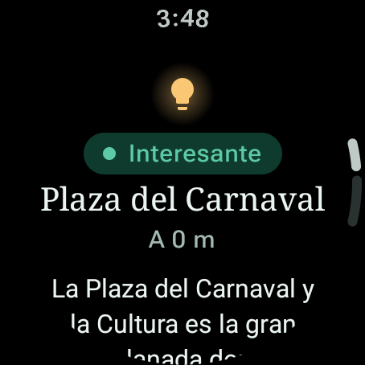
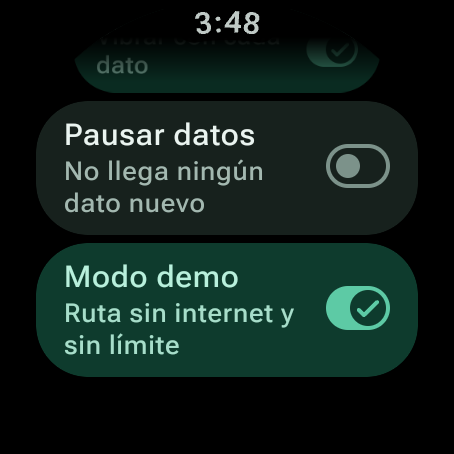
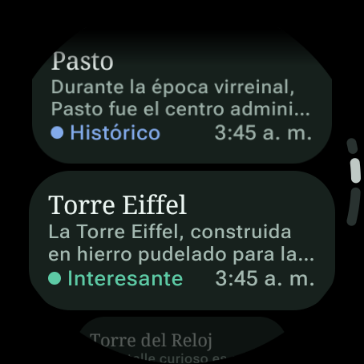

# Datos Cerca — App para SmartWatch (Wear OS)

Aplicación standalone para **Wear OS** que acompaña a la persona según su ubicación en tiempo real (en cualquier lugar del mundo) y le entrega datos breves generados con IA sobre los sitios emblemáticos que tiene cerca (plazas, iglesias, museos, teatros, monumentos). El tipo de dato y la intensidad son configurables, cuenta con historial persistente, caché por lugar y un **modo demo** sin conexión.

> **Materia: Diseño de Software.** Tanto la arquitectura (Clean Architecture + MVVM + UDF + patrones explícitos) como el diseño visual (Compose for Wear OS Material 3, design system propio y adaptación a pantallas redondas) son ejes centrales del proyecto.

---

## 1. Capturas en el emulador Wear OS

| Inicio (Explorando) | Dato real (Pasto) | Dato real (París) | Acciones del dato |
|---|---|---|---|
|  |  |  |  |

| Configuración (Intensidad) | Configuración (Modo demo) | Historial por ciudades | Small Round (192 dp) |
|---|---|---|---|
|  |  |  |  |

Todas las capturas de las Sesiones 1 y 2 (incluyendo estados de permiso, sin GPS, sin internet, fuente grande `1.24x` y pantalla pequeña) se encuentran en [`auditorias/capturas/`](auditorias/capturas/).

---

## 2. Qué hace la aplicación

- **Ubicación en tiempo real (`FusedLocationProviderClient`):** funciona en primer plano (`repeatOnLifecycle(STARTED)`), con flujo de permisos en tiempo de ejecución y detección en vivo del estado del GPS.
- **Lugares cercanos en cualquier parte del mundo (Chain of Responsibility):**
  1. **Wikipedia GeoSearch (`es.wikipedia.org`):** busca artículos geolocalizados y descarga su extracto introductorio en texto plano.
  2. **Wikipedia GeoSearch (`en.wikipedia.org`):** respaldo internacional si no hay un artículo nuevo en español.
  3. **OpenStreetMap Nominatim:** geocodificación inversa con límite estricto de máximo 1 petición por segundo y `User-Agent` descriptivo. Clasifica la relevancia según etiquetas `tourism`/`historic` y patrimoniales, y enriquece el contexto con Wikipedia cuando existe artículo del hito.
  4. **OpenAI Responses API con búsqueda web:** solo si `BuildConfig.OPENAI_WEB_SEARCH` es `true` (`false` por defecto para cuidar el presupuesto).
  5. **Municipio / región:** último recurso exclusivo del botón manual **"Dato ahora"** cuando en un radio de 500 m solo hay calles, casas o comercios ordinarios. Nunca se dispara de forma automática.
- **Filtro de relevancia (`FiltroRelevancia`):** el reloj solo habla de lugares emblemáticos (`ARTICULO_WIKIPEDIA` o `ETIQUETA_OSM_PATRIMONIAL`) dentro de `200 m` al caminar (`150–250 m`). Calles residenciales, tiendas de barrio o bancas nunca disparan un dato automático.
- **Generación con IA (`OpenAI Responses API`):** usa `PromptBuilder` con contexto recortado a `<= 1200` caracteres, límite `max_output_tokens` por intensidad y hechos estrictamente ceñidos al contexto real obtenido.
- **Caché y Modo Demo sin internet:**
  - `CacheDatos` guarda cada dato generado bajo la clave `lugar.id|tipo|intensidad` en memoria y disco (`cache_datos.json`), evitando repetir llamadas a OpenAI.
  - Al activar **Modo demo** en Configuración, se precargan los 8 sitios de `demo/ruta-pasto.gpx` en los 5 tipos y 3 niveles de intensidad, y se desactiva el tope horario (`PoliticaDemo`), permitiendo recorrer toda la ruta incluso con el Wi-Fi apagado.
- **Configuración (DataStore Preferences):**
  - Tipos con selección múltiple (mínimo uno): *Interesante, Histórico, Cómico, Curioso, Gastronómico*.
  - Interruptor **Aleatorio**: elige al azar entre los tipos marcados (o los recorre en orden fijo si está apagado).
  - **Intensidad** en 3 niveles con ventana móvil de 60 minutos:
    - **Suave:** máx. 1 dato automático/hora · 1 frase (`60` tokens).
    - **Normal:** máx. 2 datos automáticos/hora · 2 frases (`110` tokens).
    - **Intenso:** máx. 4 datos automáticos/hora · párrafo corto (`220` tokens).
  - Voz (TTS en español), vibración con patrón propio, pausa y modo demo.
- **Historial (Room):** agrupado por día (*Hoy, Ayer, fecha*), filtro de *Solo favoritos*, vista completa del dato, marcado de favorito con rebote háptico y borrado con confirmación.

---

## 3. Arquitectura

Clean Architecture ligera + MVVM + flujo de datos unidireccional (`StateFlow<UiState>` inmutable), con inyección de dependencias manual en `AppContainer`. Las dependencias apuntan siempre hacia `domain`, que es Kotlin puro sin ningún `import android.*`.

```text
app/src/main/java/com/daxlejo/datoscerca/
├── domain/   Kotlin puro: modelos, errores sellados, puertos, motor de datos y casos de uso
├── data/     Room, DataStore, FusedLocation, cadena de fuentes, OpenAI + caché, demo y plataforma
├── ui/       theme (design system), componentes reutilizables, pantallas y ViewModels
└── di/       AppContainer y FabricaViewModels
```

El documento completo con diagramas Mermaid de capas, clases, secuencia y máquina de estados está en [**`docs/arquitectura.md`**](docs/arquitectura.md).

### Patrones de diseño y dónde viven

| Patrón | Ubicación | Propósito |
|---|---|---|
| **Repository** | `domain/puerto/RepositorioHistorial`, `RepositorioConfiguracion` → `data/historial/RepositorioHistorialRoom`, `data/configuracion/RepositorioConfiguracionDataStore` | Desacoplar el dominio de Room y DataStore |
| **Chain of Responsibility** | `domain/puerto/FuenteLugares` → `data/lugares/CadenaFuentesLugares` (`FuenteWikipedia("es")` → `FuenteWikipedia("en")` → `FuenteNominatim` → `FuenteBusquedaWebOpenAi` → `FuenteMunicipio`) | Encadenar las fuentes de lugares hasta encontrar un hito relevante nuevo |
| **Strategy** | `domain/motor/PoliticaIntensidad` (`PoliticaSuave`, `PoliticaNormal`, `PoliticaIntenso`) y `SelectorTipoDato` (`SelectorEnOrden`, `SelectorAleatorio`) | Variar la regla de cupo horario/largo y la elección del tipo de dato |
| **Decorator** | `domain/motor/PoliticaDemo` y `data/ia/GeneradorDatosConCache` | Ignorar el tope horario en modo demo y cachear respuestas de OpenAI sin alterar las implementaciones base |
| **Builder** | `domain/motor/PromptBuilder` | Construir el prompt paso a paso con recorte de contexto a 1200 caracteres |
| **Observer** | `Flow` / `StateFlow` / `SharedFlow` en ubicación, configuración, historial, `MotorAutomatico` y ViewModels | Actualizar la interfaz reactivamente ante cambios de estado |
| **State** | `EstadoMotor`, `EstadoUbicacion` y los `UiState` sellados de cada pantalla | Representar cada estado de pantalla sin combinaciones inválidas |
| **Factory** | `FabricaPoliticas`, `FabricaSelectores`, `di/FabricaViewModels` | Instanciar estrategias y ViewModels |
| **Adapter** | `ProveedorUbicacionFused`, `ClienteHttpOkHttp`, `RelojSistema`, `VibradorAndroid`, `NarradorTts`, `EntradaMapper` | Traducir APIs de Android, Play Services, OkHttp y Room al dominio |

---

## 4. Design System (`ui/theme`)

- **Paleta OLED (`Color.kt`):** fondo negro `#000000`, primario teal `#1D9E75` / `#5DCAA5`, acento ámbar `#FAC775` reservado para el bombillo de descubrimiento y la estrella de favoritos, y un par `(acento, contenedor)` con contraste WCAG AA para cada `TipoDato`.
- **Tipografía (`Tokens.kt`):** nombre del lugar en `Serif` (como la placa de un monumento) y cuerpo del dato en `SansSerif` centrado con margen lateral seguro para el bisel curvo.
- **Tokens (`Tokens.kt`):** `Espaciado`, `Tamanos` (área táctil mínima de `48.dp`), `FormasDatosCerca`, `Duraciones` y `Animaciones`.
- **Componentes para pantallas redondas (`ui/componentes`):** `AppScaffold`, `ScreenScaffold`, `TransformingLazyColumn` con `SurfaceTransformation`, `EdgeButton`, `TimeText`, `PulsoExplorador`, `BombilloEncendido`, `ChipTipoDato`, `IndicadorIntensidad`, `FilaHistorial`, `BotonFavorito` y `PantallaEstado`.

---

## 5. Configuración del entorno (`local.properties`)

1. Copia [`local.properties.example`](local.properties.example) como `local.properties` en la raíz del proyecto (Git lo ignora):
   ```properties
   sdk.dir=C\:\\Users\\TU_USUARIO\\AppData\\Local\\Android\\Sdk
   OPENAI_API_KEY=
   OPENAI_MODEL=gpt-6-luna
   OPENAI_WEB_SEARCH=false
   ```
2. `BuildConfig` inyecta estas propiedades en compilación. Nunca pongas claves en el código fuente.

### Compilar, ejecutar tests y lint

```bash
./gradlew assembleDebug testDebugUnitTest lint
```

### Instalar y abrir en el emulador Wear OS

Con el emulador Wear OS abierto (verifica su serial con `adb devices`, normalmente `emulator-5554`):

```bash
adb -s emulator-5554 install -r app/build/outputs/apk/debug/app-debug.apk
adb -s emulator-5554 shell am start -n com.daxlejo.datoscerca/.ui.MainActivity
```

---

## 6. Cómo cargar la ruta GPX y usar los scripts de teletransporte

### Cargar `demo/ruta-pasto.gpx` en el emulador
1. En la barra lateral del emulador de Wear OS, haz clic en **`...` (Extended Controls)**.
2. Selecciona **Location** en el menú izquierdo y abre la pestaña **Routes**.
3. Haz clic en **Import GPX/KML** y elige el archivo [`demo/ruta-pasto.gpx`](demo/ruta-pasto.gpx) del proyecto.
4. Ajusta la velocidad en **Playback speed** (por ejemplo `2x` o `3x`) y pulsa **Play route**.
   - La ruta recorre 8 hitos verificados en OpenStreetMap del centro histórico de Pasto: *Museo Taminango → Teatro Imperial → Catedral de Pasto → Templo de San Juan Bautista → Plaza de Nariño → Templo de Cristo Rey → Museo del Oro Nariño → Plaza del Carnaval*.

### Scripts de teletransporte (`adb emu geo fix`)
Recuerda que `adb emu geo fix` recibe **primero la longitud y luego la latitud**. Los scripts [`demo/teletransporte.bat`](demo/teletransporte.bat) (Windows) y [`demo/teletransporte.sh`](demo/teletransporte.sh) (Linux/macOS/Git Bash) ya envían las coordenadas en el orden correcto y detectan automáticamente el emulador activo:

```bat
REM En Windows (PowerShell o CMD):
.\demo\teletransporte.bat pasto
.\demo\teletransporte.bat bogota
.\demo\teletransporte.bat cartagena
.\demo\teletransporte.bat paris
.\demo\teletransporte.bat calle
```

```bash
# En Bash:
./demo/teletransporte.sh pasto
./demo/teletransporte.sh bogota
./demo/teletransporte.sh cartagena
./demo/teletransporte.sh paris
./demo/teletransporte.sh calle
```

---

## 7. Guion de demostración de 5 minutos (para la exposición)

1. **Minuto 0:00 – Presentación e Inicio (45 s):**
   - Muestra el ícono de **Datos Cerca** (pin teal + bombillo ámbar) en el launcher del reloj y abre la app.
   - Concede el permiso de ubicación en el diálogo del sistema. La pantalla **Inicio** pasa a *Explorando* con las ondas expansivas del pin.
2. **Minuto 0:45 – Recorrido por el centro de Pasto con `ruta-pasto.gpx` (1 min 15 s):**
   - Abre **Configuración** (ícono de engranaje), activa **Modo demo** para quitar el límite horario en la exposición y vuelve a **Inicio**.
   - En *Extended Controls → Location → Routes*, dale **Play** a `demo/ruta-pasto.gpx`.
   - Al empezar en una calle común junto a una tienda, el reloj no dice nada (`FiltroRelevancia`). Al acercarse a menos de 200 m del **Museo Taminango**, el **Teatro Imperial**, la **Catedral de Pasto** y la **Plaza de Nariño**, el reloj vibra y abre automáticamente la pantalla **Dato** con la animación del bombillo encendiéndose.
3. **Minuto 2:00 – Personalización de tono e intensidad + Teletransporte global (1 min 30 s):**
   - En **Configuración**, marca **Cómico** e **Histórico**, y selecciona la intensidad **Intenso** (*Hasta 4 por hora, un párrafo*).
   - Ejecuta `.\demo\teletransporte.bat bogota` y toca **Dato ahora**: aparece un dato real de la **Catedral primada de Colombia / Plaza de Bolívar** generado por OpenAI a partir de Wikipedia.
   - Ejecuta `.\demo\teletransporte.bat cartagena` y toca **Dato ahora**: aparece el dato de la **Torre del Reloj**.
   - Ejecuta `.\demo\teletransporte.bat paris` y toca **Dato ahora**: aparece el dato de la **Torre Eiffel** en español.
4. **Minuto 3:30 – Calle sin lugares emblemáticos vs. "Dato ahora" (45 s):**
   - Ejecuta `.\demo\teletransporte.bat calle` (calle residencial sin ningún hito en 500 m).
   - Muestra que en modo automático el reloj permanece en *Explorando* sin interrumpir.
   - Pulsa **Dato ahora**: la cadena de fuentes llega al último eslabón (`FuenteMunicipio`) y responde con un dato sobre el municipio de **Pasto**.
5. **Minuto 4:15 – Modo demo sin internet e Historial (45 s):**
   - Desactiva el Wi-Fi del computador o del emulador con **Modo demo** activo y avanza por la ruta de Pasto: los datos precargados en `CacheDatos` siguen abriéndose al instante sin red y sin gastar tokens.
   - Abre **Historial** (ícono de reloj), muestra las entradas agrupadas bajo *Hoy*, marca un dato como favorito con la estrella ámbar y activa el filtro **Solo favoritos**.
