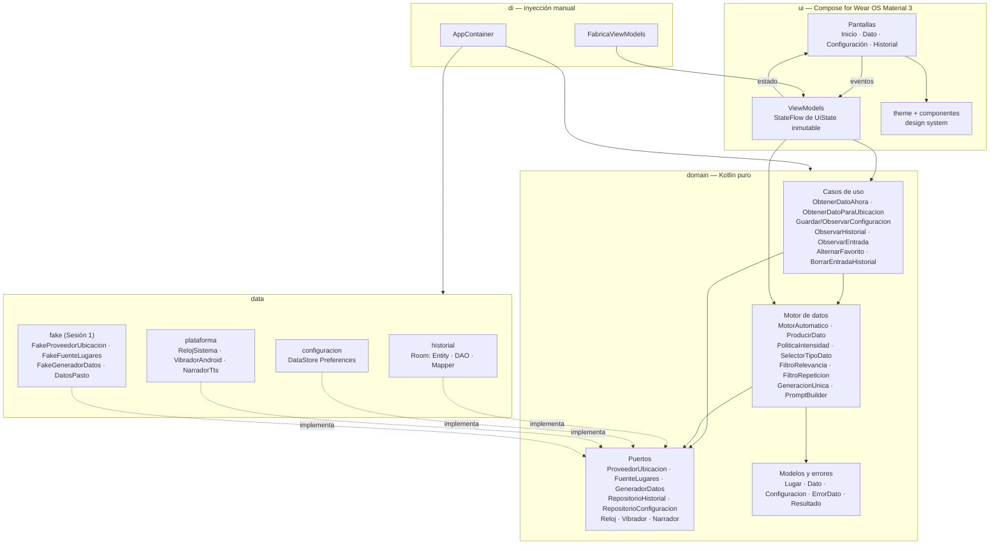
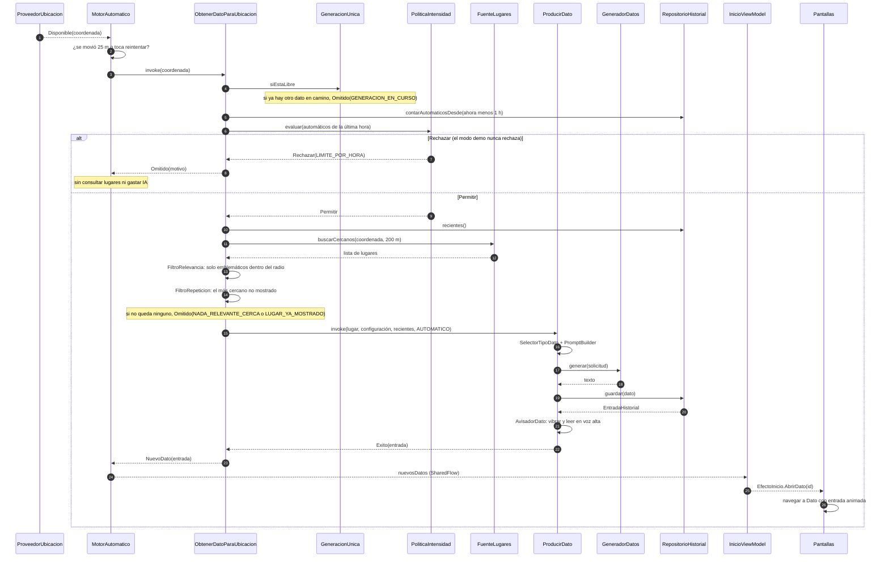
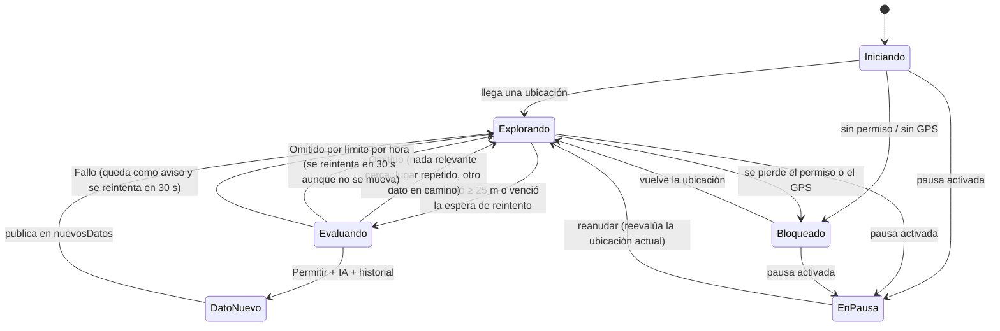

# Arquitectura — Datos Cerca (Wear OS)

Estado: **Sesión 1**. Todo funciona sin red; la ubicación, los lugares y la IA son *fakes* detrás de las interfaces del dominio. La Sesión 2 conecta las implementaciones reales sin tocar el dominio.

## 1. Idea general

Clean Architecture ligera + MVVM + flujo de datos unidireccional, en un solo módulo Gradle (`app`) con cuatro paquetes:

| Paquete | Qué contiene | Depende de |
|---|---|---|
| `domain` | Modelos, errores, puertos (interfaces), motor de datos y casos de uso. Kotlin puro: ningún `import android.*` | nada |
| `data` | Room, DataStore, adaptadores de plataforma (reloj, vibración, voz) y los fakes | `domain` |
| `ui` | Design system, componentes, pantallas y ViewModels | `domain` |
| `di` | `AppContainer` y `FabricaViewModels`: el único lugar que conoce las clases concretas | todos |

Las dependencias apuntan siempre hacia `domain`. `ui` nunca importa `data`.

## 2. Capas y componentes



## 3. Modelo del dominio

```mermaid
classDiagram
    class Coordenada {
        +Double latitud
        +Double longitud
        +distanciaMetrosA(otra) Double
    }
    class Lugar {
        +String id
        +String nombre
        +int distanciaMetros
        +String contexto
        +String fuente
        +Relevancia relevancia
    }
    class Relevancia {
        <<enumeration>>
        ARTICULO_WIKIPEDIA
        ETIQUETA_OSM_PATRIMONIAL
        NINGUNA
        +boolean emblematico
    }
    class Dato {
        +String texto
        +long generadoEnMs
        +OrigenDato origen
    }
    class OrigenDato {
        <<enumeration>>
        AUTOMATICO
        MANUAL
    }
    class EntradaHistorial {
        +long id
        +boolean favorito
    }
    class Configuracion {
        +Set~TipoDato~ tipos
        +boolean aleatorio
        +boolean vozActiva
        +boolean vibracionActiva
        +boolean pausa
        +boolean modoDemo
        +puedeDesmarcar(tipo) boolean
        +conTipoAlternado(tipo) Configuracion
    }
    class TipoDato {
        <<enumeration>>
        INTERESANTE
        HISTORICO
        COMICO
        CURIOSO
        GASTRONOMICO
    }
    class Intensidad {
        <<enumeration>>
        SUAVE
        NORMAL
        INTENSO
    }
    class PoliticaIntensidad {
        <<interface>>
        +Intensidad intensidad
        +FormatoDato formato
        +evaluar(automaticosUltimaHora) Decision
    }
    class PoliticaDemo {
        +evaluar(n) Decision
    }
    class FiltroRelevancia {
        +int radioLlegadaMetros
        +alLlegar(cercanos) List~Lugar~
        +emblematicos(cercanos) List~Lugar~
    }
    class GeneracionUnica {
        +siEstaLibre(accion) T
    }
    class SelectorTipoDato {
        <<interface>>
        +seleccionar(tipos, anterior) TipoDato
    }
    class FiltroRepeticion {
        +idsAExcluir(recientes, ahoraMs) Set~String~
    }
    class PromptBuilder {
        +lugar(l) PromptBuilder
        +tipo(t) PromptBuilder
        +formato(f) PromptBuilder
        +build() Prompt
    }
    class FuenteLugares {
        <<interface>>
        +buscarCercanos(coordenada, radioMetros) Resultado
    }
    class GeneradorDatos {
        <<interface>>
        +generar(solicitud) Resultado~String~
    }
    class ProveedorUbicacion {
        <<interface>>
        +ubicaciones() Flow~EstadoUbicacion~
        +ubicacionActual() Resultado~Coordenada~
    }
    class RepositorioHistorial {
        <<interface>>
        +observar() Flow~Resultado~
        +contarAutomaticosDesde(desdeMs) Resultado
        +guardar(dato) Resultado~EntradaHistorial~
        +alternarFavorito(id) Resultado
        +borrar(id) Resultado
    }
    class RepositorioConfiguracion {
        <<interface>>
        +observar() Flow~Configuracion~
        +actualizar(cambio) Resultado
    }

    Lugar --> Coordenada
    Lugar --> Relevancia
    Dato --> Lugar
    Dato --> OrigenDato
    Dato --> TipoDato
    Dato --> Intensidad
    EntradaHistorial --> Dato
    Configuracion --> TipoDato
    Configuracion --> Intensidad
    PoliticaIntensidad <|.. PoliticaSuave
    PoliticaIntensidad <|.. PoliticaNormal
    PoliticaIntensidad <|.. PoliticaIntenso
    PoliticaIntensidad <|.. PoliticaDemo
    PoliticaDemo o-- PoliticaIntensidad : decora
    SelectorTipoDato <|.. SelectorEnOrden
    SelectorTipoDato <|.. SelectorAleatorio
    ProducirDato --> GeneradorDatos
    ProducirDato --> RepositorioHistorial
    ProducirDato --> SelectorTipoDato
    ProducirDato --> PromptBuilder
    ObtenerDatoParaUbicacion --> FuenteLugares
    ObtenerDatoParaUbicacion --> PoliticaIntensidad
    ObtenerDatoParaUbicacion --> FiltroRepeticion
    ObtenerDatoParaUbicacion --> FiltroRelevancia
    ObtenerDatoParaUbicacion --> GeneracionUnica
    ObtenerDatoParaUbicacion --> ProducirDato
    ObtenerDatoAhora --> ProveedorUbicacion
    ObtenerDatoAhora --> FuenteLugares
    ObtenerDatoAhora --> FiltroRelevancia
    ObtenerDatoAhora --> GeneracionUnica
    ObtenerDatoAhora --> ProducirDato
    MotorAutomatico --> ProveedorUbicacion
    MotorAutomatico --> RepositorioConfiguracion
    MotorAutomatico --> ObtenerDatoParaUbicacion
```



### Errores

No se lanzan excepciones para fallos esperados. Todo puerto devuelve `Resultado<T>` (`Exito` o `Fallo(ErrorDato)`), y `ErrorDato` es una jerarquía sellada: `SinPermiso` y `SinGps` (que son `ErrorUbicacion`), `SinInternet`, `SinLugares`, `FuenteNoDisponible`, `ErrorIa`, `EnPausa`, `VozNoDisponible`, `GeneracionEnCurso` y `Almacenamiento`. La interfaz tiene un estado diseñado para cada uno (`ui/util/Textos.kt`).

Los flujos del historial (`observar`, `observarEntrada`) también emiten `Resultado`: si Room falla al leer, `RepositorioHistorialRoom` captura la `SQLiteException` y emite `Fallo(Almacenamiento)`, que Historial y Dato muestran como pantalla de error en lugar de cerrar la app.

Omitir un dato automático no es un error: `ObtenerDatoParaUbicacion` devuelve `Exploracion`, que distingue `NuevoDato`, `Omitido(motivo)` y `Fallo(error)`.

## 4. Secuencia: la persona pasa cerca de un lugar relevante



El dato manual ("Dato ahora") sigue el mismo tramo final (`ProducirDato`), pero lo inicia `ObtenerDatoAhora`: ignora el límite por hora y no cuenta para él (se guarda con origen `MANUAL`), busca en un radio mayor (500 m), solo acepta lugares emblemáticos y, si todos ya se mostraron, repite el más cercano. Comparte la misma `GeneracionUnica` que el automático: si ya viene un dato en camino responde `Fallo(GeneracionEnCurso)` y la interfaz espera ese dato en lugar de pedir otro.

## 5. Estados del motor de datos



`Evaluando` y `DatoNuevo` son pasos internos de `MotorAutomatico.explorar`; hacia afuera el motor publica `Iniciando`, `Explorando`, `EnPausa` y `Bloqueado` (`EstadoMotor`).

### Reglas de intensidad

Un dato automático solo sale al pasar cerca de un lugar **relevante** (`FiltroRelevancia`): con artículo de Wikipedia o etiquetas OSM `tourism`/`historic` (`Lugar.relevancia`, que llena la fuente) y a no más de `radioLlegadaMetros` (configurable entre 150 y 250 m; 200 m por defecto en `AppContainer`). Además debe caber en el límite por hora del nivel:

| Nivel | Máximo de datos automáticos | Largo | Tope de tokens |
|---|---|---|---|
| Suave | 1 por hora | 1 frase | 60 |
| Normal | 2 por hora | 2 frases | 110 |
| Intenso | 4 por hora | Párrafo corto | 220 |

- La hora es una **ventana móvil**: se cuentan en el historial los datos con origen `AUTOMATICO` de los últimos 60 minutos (`RepositorioHistorial.contarAutomaticosDesde`). No hay un intervalo fijo entre datos: dos pueden salir seguidos si el cupo lo permite.
- El **modo demo** (`Configuracion.modoDemo`) envuelve la política en `PoliticaDemo` (Decorator): conserva el largo del nivel y nunca rechaza por el límite.
- **"Dato ahora"** nunca consulta el límite ni lo gasta.
- "Lugar nuevo" significa que no aparece en el historial de los últimos 30 minutos (`FiltroRepeticion`); si el relevante más cercano ya se mostró, se usa el siguiente relevante del radio.

## 6. Patrones de diseño y dónde viven

| Patrón | Dónde | Para qué |
|---|---|---|
| **Repository** | `domain/puerto/RepositorioHistorial`, `RepositorioConfiguracion` → `data/historial/RepositorioHistorialRoom`, `data/configuracion/RepositorioConfiguracionDataStore` | El dominio no sabe si los datos están en Room o en DataStore |
| **Strategy** | `domain/motor/PoliticaIntensidad` (`PoliticaSuave`, `PoliticaNormal`, `PoliticaIntenso`) | Cada nivel decide cuántos datos automáticos caben por hora y qué tan largos son |
| **Decorator** | `domain/motor/PoliticaDemo` | El modo demo quita el límite por hora sin tocar las políticas |
| **Strategy** | `domain/motor/SelectorTipoDato` (`SelectorEnOrden`, `SelectorAleatorio`) | Selección fija o al azar entre los tipos marcados |
| **Factory** | `FabricaPoliticas`, `FabricaSelectores`, `di/FabricaViewModels` | Elegir la estrategia según la configuración y construir ViewModels |
| **Builder** | `domain/motor/PromptBuilder` | Armar el prompt paso a paso: lugar, tipo y formato |
| **Observer** | `Flow`/`StateFlow`/`SharedFlow`: configuración, historial, ubicación, `MotorAutomatico.estado` y `nuevosDatos`, `uiState` de cada ViewModel | La interfaz reacciona a los cambios sin consultar |
| **State** | `EstadoMotor` + `MotorAutomatico`; `UiState` sellados de cada pantalla | Estados explícitos; los imposibles no se pueden representar |
| **Adapter** | `data/plataforma/RelojSistema`, `VibradorAndroid`, `NarradorTts`; `data/historial/EntradaMapper` | Traducir APIs de Android y filas de Room a los puertos y modelos del dominio |
| **Chain of Responsibility** | `domain/puerto/FuenteLugares` (contrato preparado) | En la Sesión 2 una `CadenaFuentesLugares` encadenará Wikipedia → Nominatim → búsqueda web → región. Una lista vacía significa "pasa a la siguiente"; la relevancia de cada lugar la marca su fuente |
| **Exclusión mutua** | `domain/motor/GeneracionUnica` (un `Mutex` con `tryLock`) | El dato manual y el automático nunca se generan a la vez ni uno detrás del otro |
| **Inyección de dependencias manual** | `di/AppContainer` | Un solo punto de ensamblaje; cambiar fakes por reales son tres líneas |
| **MVVM + UDF** | `ui/*/…ViewModel` + `…Pantalla` | Eventos suben, estado inmutable baja; los composables no deciden nada |

## 7. Flujo de datos en la interfaz

- Cada pantalla tiene un par `XRuta` (conecta el ViewModel) y `XPantalla` (sin estado, solo pinta). Las previews usan `XPantalla` directamente.
- El `UiState` es una jerarquía sellada e inmutable expuesta como `StateFlow` y recogida con `collectAsStateWithLifecycle`.
- Los efectos de una sola vez (abrir un dato, cerrar la pantalla tras borrar) viajan por un `Channel`, no por el estado.
- Vibrar y leer en voz alta no son efectos de interfaz: son puertos del dominio (`Vibrador`, `Narrador`) que invoca `AvisadorDato`, igual para el dato manual y el automático.
- `MotorAutomatico` es un singleton del contenedor. Lo ejecuta `MainActivity` con `repeatOnLifecycle(STARTED)`: solo trabaja con la app en primer plano.

## 8. Qué cambia en la Sesión 2

Solo `AppContainer`:

```kotlin
private val proveedorUbicacion: ProveedorUbicacion = FakeProveedorUbicacion(escenarioFake)   // → Fused Location
private val fuenteLugares: FuenteLugares = FakeFuenteLugares(escenarioFake)                  // → CadenaFuentesLugares
private val generadorDatos: GeneradorDatos = FakeGeneradorDatos(escenarioFake)               // → OpenAI + caché
```

Lo que ya quedó preparado en el dominio:

- `FuenteLugares.buscarCercanos(coordenada, radioMetros)` devuelve todos los lugares del radio con su `Relevancia`; el dominio elige con `FiltroRelevancia` y `FiltroRepeticion`. Wikipedia marcará `ARTICULO_WIKIPEDIA` y Nominatim `ETIQUETA_OSM_PATRIMONIAL` o `NINGUNA` según sus etiquetas.
- Falta el último recurso "dato del municipio" para "Dato ahora" cuando no hay ningún lugar emblemático: hoy responde `SinLugares`.
- `SolicitudGeneracion.claveCache` (lugar + tipo + intensidad) para un decorador de caché.
- `Prompt.maxTokensSalida` y el recorte de contexto a 1200 caracteres en `PromptBuilder`.
- `ErrorDato.SinInternet`, `FuenteNoDisponible` y `ErrorIa` para mapear timeouts y respuestas 5xx.
- `EstadoUbicacion.NoDisponible(motivo)` para el flujo de permisos.
- `Configuracion.modoDemo`, ya persistido.

## 9. Decisiones que conviene conocer

- **El dato manual puede repetir un lugar.** Si todo lo cercano ya se mostró, `ObtenerDatoAhora` repite el más cercano en lugar de dejar a la persona sin respuesta.
- **Un dato automático no interrumpe otra pantalla.** Si la persona está en Historial o Configuración, el dato vibra, se guarda y queda en el historial; solo se abre solo cuando está en Inicio.
- **Dos radios de búsqueda**: `FiltroRelevancia.radioLlegadaMetros` (200 m, entre 150 y 250) para el automático y `RadioBusqueda.CERCANIA_METROS` (500 m) para "Dato ahora".
- **Borrar un dato automático libera su cupo.** El límite se calcula sobre el historial guardado.
- **Historial v2.** La base pasó a la versión 2 con `MIGRACION_1_2`, que agrega `lugar_relevancia` y `origen`. Lo guardado antes queda como `MANUAL`, así que no gasta cupo.
- **`Lugar.contexto` no se guarda en el historial.** Solo sirve para generar; al leer una entrada llega vacío.
