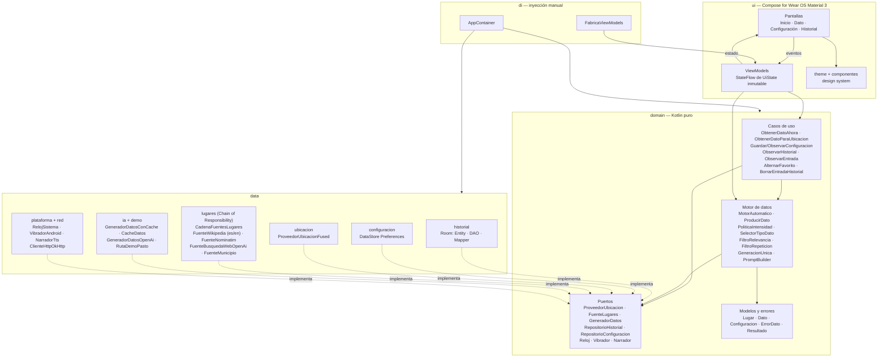
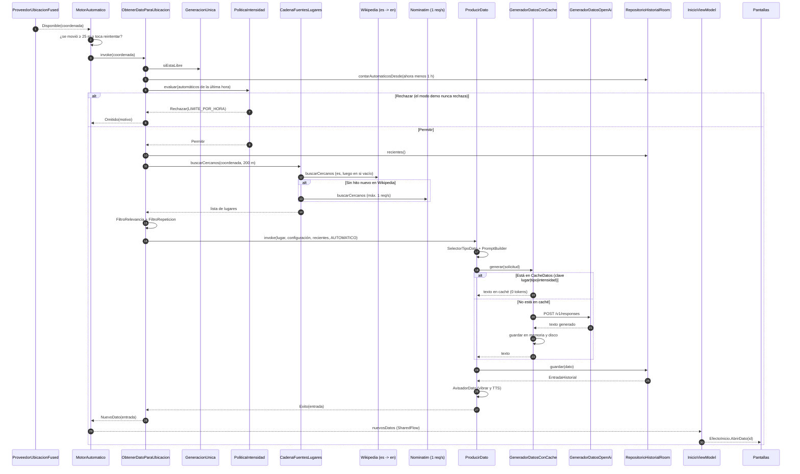
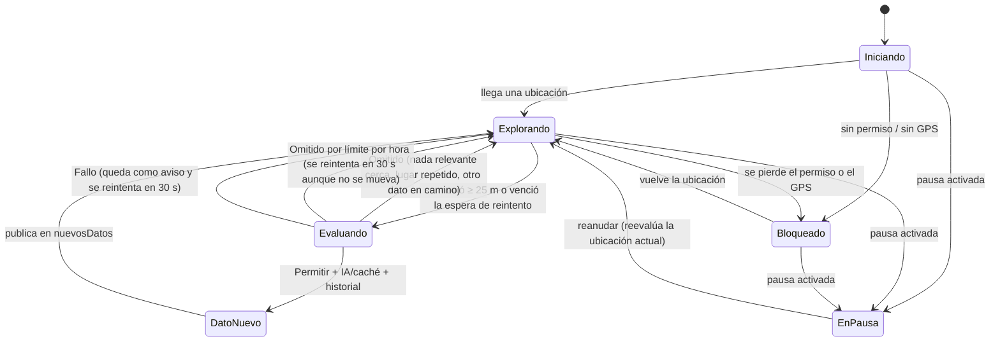

# Arquitectura — ExplorIA (Wear OS)

Estado: **Versión final (Sesión 2 de 2)**. El dominio permanece en Kotlin puro sin tocar sus contratos; la capa `data` conecta ubicación real en primer plano (`FusedLocationProviderClient`), la cadena de fuentes de lugares en cualquier parte del mundo (Wikipedia `es` → Wikipedia `en` → Nominatim → OpenAI Web Search → Municipio/región) y la generación real con OpenAI (`Responses API`) decorada con caché por `lugar + tipo + intensidad` y precarga sin conexión para el modo demo.

## 1. Idea general

Clean Architecture ligera + MVVM + flujo de datos unidireccional, en un solo módulo Gradle (`app`) con cuatro paquetes:

| Paquete | Qué contiene | Depende de |
|---|---|---|
| `domain` | Modelos, errores, puertos (interfaces), motor de datos y casos de uso. Kotlin puro: ningún `import android.*` | nada |
| `data` | Room, DataStore, ubicación Fused Location, cadena de fuentes de lugares, cliente OpenAI con caché, ruta demo y adaptadores de plataforma (reloj, vibración, voz) | `domain` |
| `ui` | Design system, componentes, pantallas y ViewModels | `domain` |
| `di` | `AppContainer` y `FabricaViewModels`: el único lugar que conoce las clases concretas | todos |

Las dependencias apuntan siempre hacia `domain`. `ui` nunca importa `data` (salvo `MainActivity` al coordinar el permiso del sistema con el contenedor).

## 2. Capas y componentes

## 3. Modelo del dominio y adaptadores reales

```mermaid
classDiagram
    class Coordenada {
        +Double latitud
        +Double longitud
        +distanciaMetrosA(otra) Double
    }
    class Lugar {
        +String id
        +String nombre
        +int distanciaMetros
        +String contexto
        +String fuente
        +Relevancia relevancia
    }
    class Relevancia {
        <<enumeration>>
        ARTICULO_WIKIPEDIA
        ETIQUETA_OSM_PATRIMONIAL
        NINGUNA
        +boolean emblematico
    }
    class Dato {
        +String texto
        +long generadoEnMs
        +OrigenDato origen
    }
    class OrigenDato {
        <<enumeration>>
        AUTOMATICO
        MANUAL
    }
    class EntradaHistorial {
        +long id
        +boolean favorito
    }
    class Configuracion {
        +Set~TipoDato~ tipos
        +boolean aleatorio
        +boolean vozActiva
        +boolean vibracionActiva
        +boolean pausa
        +boolean modoDemo
        +puedeDesmarcar(tipo) boolean
        +conTipoAlternado(tipo) Configuracion
    }
    class PoliticaIntensidad {
        <<interface>>
        +Intensidad intensidad
        +FormatoDato formato
        +evaluar(automaticosUltimaHora) Decision
    }
    class PoliticaDemo {
        +evaluar(n) Decision
    }
    class FiltroRelevancia {
        +int radioLlegadaMetros
        +alLlegar(cercanos) List~Lugar~
        +emblematicos(cercanos) List~Lugar~
    }
    class GeneracionUnica {
        +siEstaLibre(accion) T
    }
    class SelectorTipoDato {
        <<interface>>
        +seleccionar(tipos, anterior) TipoDato
    }
    class FiltroRepeticion {
        +idsAExcluir(recientes, ahoraMs) Set~String~
    }
    class PromptBuilder {
        +lugar(l) PromptBuilder
        +tipo(t) PromptBuilder
        +formato(f) PromptBuilder
        +build() Prompt
    }
    class FuenteLugares {
        <<interface>>
        +buscarCercanos(coordenada, radioMetros) Resultado~List~Lugar~~
    }
    class CadenaFuentesLugares {
        -List~FuenteLugares~ fuentes
        +buscarCercanos(coordenada, radioMetros) Resultado~List~Lugar~~
    }
    class FuenteWikipedia {
        -String idioma
        +buscarCercanos(coordenada, radioMetros) Resultado~List~Lugar~~
    }
    class FuenteNominatim {
        -LimitadorFrecuencia limitador
        +buscarCercanos(coordenada, radioMetros) Resultado~List~Lugar~~
    }
    class FuenteBusquedaWebOpenAi {
        -boolean habilitada
        +buscarCercanos(coordenada, radioMetros) Resultado~List~Lugar~~
    }
    class FuenteMunicipio {
        +buscarCercanos(coordenada, radioMetros) Resultado~List~Lugar~~
    }
    class GeneradorDatos {
        <<interface>>
        +generar(solicitud) Resultado~String~
    }
    class GeneradorDatosConCache {
        -GeneradorDatos delegado
        -CacheDatos cache
        +generar(solicitud) Resultado~String~
    }
    class GeneradorDatosOpenAi {
        +generar(solicitud) Resultado~String~
    }
    class ProveedorUbicacion {
        <<interface>>
        +ubicaciones() Flow~EstadoUbicacion~
        +ubicacionActual() Resultado~Coordenada~
    }
    class ProveedorUbicacionFused {
        +ubicaciones() Flow~EstadoUbicacion~
        +ubicacionActual() Resultado~Coordenada~
        +refrescarEstado()
    }

    Lugar --> Coordenada
    Lugar --> Relevancia
    Dato --> Lugar
    Dato --> OrigenDato
    EntradaHistorial --> Dato
    PoliticaIntensidad <|.. PoliticaSuave
    PoliticaIntensidad <|.. PoliticaNormal
    PoliticaIntensidad <|.. PoliticaIntenso
    PoliticaIntensidad <|.. PoliticaDemo
    PoliticaDemo o-- PoliticaIntensidad : decora
    SelectorTipoDato <|.. SelectorEnOrden
    SelectorTipoDato <|.. SelectorAleatorio
    FuenteLugares <|.. CadenaFuentesLugares
    FuenteLugares <|.. FuenteWikipedia
    FuenteLugares <|.. FuenteNominatim
    FuenteLugares <|.. FuenteBusquedaWebOpenAi
    FuenteLugares <|.. FuenteMunicipio
    FuenteLugares <|.. FuenteLugaresDemo
    CadenaFuentesLugares o-- FuenteLugares : encadena
    GeneradorDatos <|.. GeneradorDatosConCache
    GeneradorDatos <|.. GeneradorDatosOpenAi
    GeneradorDatosConCache o-- GeneradorDatos : decora
    ProveedorUbicacion <|.. ProveedorUbicacionFused
    ProducirDato --> GeneradorDatos
    ProducirDato --> PromptBuilder
    ObtenerDatoParaUbicacion --> FuenteLugares
    ObtenerDatoParaUbicacion --> PoliticaIntensidad
    ObtenerDatoParaUbicacion --> FiltroRelevancia
    ObtenerDatoParaUbicacion --> FiltroRepeticion
    ObtenerDatoParaUbicacion --> GeneracionUnica
    ObtenerDatoParaUbicacion --> ProducirDato
    ObtenerDatoAhora --> ProveedorUbicacion
    ObtenerDatoAhora --> FuenteLugares
    ObtenerDatoAhora --> FiltroRelevancia
    ObtenerDatoAhora --> GeneracionUnica
    ObtenerDatoAhora --> ProducirDato
```

### Errores

No se lanzan excepciones para fallos esperados. Todo puerto devuelve `Resultado<T>` (`Exito` o `Fallo(ErrorDato)`), y `ErrorDato` es una jerarquía sellada: `SinPermiso` y `SinGps` (que son `ErrorUbicacion`), `SinInternet`, `SinLugares`, `FuenteNoDisponible`, `ErrorIa`, `EnPausa`, `VozNoDisponible`, `GeneracionEnCurso` y `Almacenamiento`. La interfaz tiene un estado diseñado para cada uno (`ui/util/Textos.kt`).

- `ClienteHttpOkHttp` captura `UnknownHostException`, `ConnectException` y `NoRouteToHostException` como `SinConexion` (`ErrorDato.SinInternet`), y los tiempos agotados o fallos HTTP 4xx/5xx como `ErrorServidor`/`FalloTransporte`, que las fuentes traducen a `FuenteNoDisponible` y el cliente de IA a `ErrorIa`.
- Los flujos del historial (`observar`, `observarEntrada`) capturan `SQLiteException` y emiten `Fallo(Almacenamiento)`.
- Omitir un dato automático no es un error: `ObtenerDatoParaUbicacion` devuelve `Exploracion`, que distingue `NuevoDato`, `Omitido(motivo)` y `Fallo(error)`.

## 4. Secuencia: la persona llega a un lugar relevante (o pide "Dato ahora")

En **"Dato ahora"** (`ObtenerDatoAhora`), el radio de búsqueda sube a `500 m` y se habilita el último eslabón de la cadena (`FuenteMunicipio`): si ni Wikipedia (`es`/`en`), ni Nominatim, ni la búsqueda web encuentran un lugar emblemático en 500 m (por ejemplo, en una calle residencial), `FuenteMunicipio` construye un lugar para el municipio o la región a partir de la dirección administrativa de Nominatim y el resumen de Wikipedia del municipio. En modo automático (`radio <= 250 m`) `FuenteMunicipio` nunca participa.

## 5. Estados del motor de datos

### Reglas de intensidad y ahorro de presupuesto

| Nivel | Máximo de datos automáticos | Largo | Tope de tokens (`max_output_tokens`) |
|---|---|---|---|
| Suave | 1 por hora | 1 frase | 60 |
| Normal | 2 por hora | 2 frases | 110 |
| Intenso | 4 por hora | Párrafo corto | 220 |

- **Ventana móvil de 60 minutos:** se cuentan en Room los datos con origen `AUTOMATICO` de la última hora.
- **Modo demo (`Configuracion.modoDemo`):** envuelve la política en `PoliticaDemo` (sin límite por hora), precarga en `CacheDatos` los 8 hitos de la ruta de Pasto (`RutaDemoPasto`) en los 5 tipos y las 3 intensidades, y habilita `FuenteLugaresDemo` para que toda la ruta funcione incluso con el Wi-Fi apagado.
- **Presupuesto de OpenAI:** `PromptBuilder` recorta el contexto a un máximo de 1200 caracteres sin partir palabras, `GeneradorDatosOpenAi` limita `max_output_tokens` según la intensidad y desactiva los tokens de razonamiento (`reasoning.effort = "none"`) en modelos `gpt-5`/`gpt-6`, y `GeneradorDatosConCache` impide repetir llamadas para la misma combinación `lugar.id|tipo|intensidad`.

## 6. Patrones de diseño y dónde viven

| Patrón | Dónde | Para qué |
|---|---|---|
| **Repository** | `domain/puerto/RepositorioHistorial`, `RepositorioConfiguracion` → `data/historial/RepositorioHistorialRoom`, `data/configuracion/RepositorioConfiguracionDataStore` | Aislar al dominio de Room y DataStore |
| **Chain of Responsibility** | `domain/puerto/FuenteLugares` → `data/lugares/CadenaFuentesLugares` (`FuenteWikipedia("es")` → `FuenteWikipedia("en")` → `FuenteNominatim` → `FuenteBusquedaWebOpenAi` → `FuenteMunicipio`) | Buscar lugares cercanos en cualquier parte del mundo pasando al siguiente eslabón cuando no hay un hito nuevo |
| **Strategy** | `domain/motor/PoliticaIntensidad` (`PoliticaSuave`, `PoliticaNormal`, `PoliticaIntenso`) y `SelectorTipoDato` (`SelectorEnOrden`, `SelectorAleatorio`) | Intercambiar la regla de frecuencia/largo y la elección del tipo de dato |
| **Decorator** | `domain/motor/PoliticaDemo` y `data/ia/GeneradorDatosConCache` | Quitar el límite por hora en modo demo y añadir caché transparente delante de OpenAI sin modificar las clases base |
| **Factory** | `FabricaPoliticas`, `FabricaSelectores`, `di/FabricaViewModels` | Instanciar estrategias y ViewModels |
| **Builder** | `domain/motor/PromptBuilder` | Construir el prompt paso a paso (lugar, tipo, formato y recorte de contexto a 1200 caracteres) |
| **Observer** | `Flow`/`StateFlow`/`SharedFlow` en ubicación, configuración, historial, `MotorAutomatico` y ViewModels | Flujo reactivo unidireccional hacia la interfaz |
| **State** | `EstadoMotor`, `EstadoUbicacion` y los `UiState` sellados de cada pantalla | Modelar estados explícitos sin combinaciones inválidas |
| **Adapter** | `data/ubicacion/ProveedorUbicacionFused`, `data/plataforma/RelojSistema`, `VibradorAndroid`, `NarradorTts`, `data/red/ClienteHttpOkHttp`, `data/historial/EntradaMapper` | Adaptar APIs de Android, Google Play Services, OkHttp y Room a los contratos del dominio |
| **Exclusión mutua / Rate Limiting** | `domain/motor/GeneracionUnica` y `data/lugares/LimitadorFrecuencia` | Evitar dos generaciones simultáneas y respetar el máximo de 1 petición por segundo de Nominatim |
| **Inyección de dependencias manual** | `di/AppContainer` | Único punto de ensamblaje de toda la aplicación |
| **MVVM + UDF** | `ui/*/…ViewModel` + `…Pantalla` | Eventos hacia arriba, `UiState` inmutable hacia abajo y cero lógica de negocio en los Composables |
